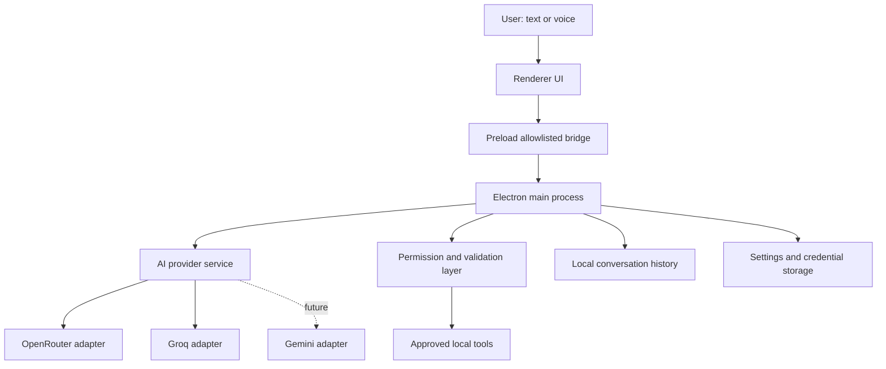
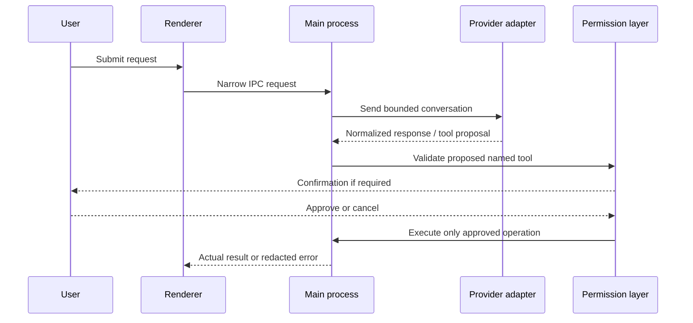

# Architecture

**Status:** Proposed architecture; confirm against source code before implementation. No unverified feature should be represented as present.

## Principles
Keep privileged OS operations in Electron's main process. Renderer code handles presentation only. The preload bridge exposes narrowly scoped methods. Provider adapters normalize responses and errors. Tool execution uses named allowlisted actions and validated arguments.

## System diagram


## Command flow


## Components and boundaries
- **Main process:** owns provider requests, IPC handlers, local persistence, permission checks, and OS integrations.
- **Preload:** exports explicit functions only; no generic IPC, filesystem, shell, or Node API exposure.
- **Renderer:** displays chat/settings/history and collects user input; Node integration disabled.
- **Provider adapter:** implements provider-specific endpoint/auth/request parsing, timeout, and normalized errors.
- **Voice service:** wraps browser-supported recognition/synthesis; no background recording.
- **Tool registry:** fixed names mapped to trusted functions and strict argument schemas. Model output is untrusted.
- **Permission service:** validates user-approved workspace, canonical paths, schemes, confirmation state, and cancellation.
- **History service:** stores bounded local conversation data; deletion confirms first.
- **Settings/credentials:** settings are local; secrets use OS-backed secure storage where available.

## Data flow
1. User input enters renderer.
2. Preload forwards a narrow, validated request to main.
3. Main selects provider and sends only required recent context.
4. Responses are normalized and safely rendered; markdown must not allow script/HTML execution.
5. Any proposed tool call is validated independently of the model's claims.
6. Permission checks and user confirmation precede side effects.
7. The real OS result or redacted error is returned to UI.

## Proposed directory layout
```text
src/
  main.js
  preload.js
  index.html
  styles.css
  renderer.js
  services/
    ai-provider.js
    openrouter.js
    groq.js
    voice.js
    history.js
  tools/
    filesystem.js
    system.js
  security/
    permissions.js
tests/
```

## Dependency rules
- Renderer must not import Node built-ins or provider secrets.
- Tool modules are callable only through main-process validation.
- Provider modules do not directly execute local actions.
- Shared data contracts should be simple and schema-validated.
- Keep dependencies minimal and maintained.

## Decisions and trade-offs
Electron provides desktop integration and web UI familiarity but increases package size and requires careful hardening. Vanilla JS keeps the initial project approachable but may require stricter module boundaries as complexity grows. JSON is simple for initial local persistence but needs atomic writes, bounded history, and corruption recovery. Browser speech APIs reduce dependencies but support varies. OS-backed secret storage improves protection but may require platform-specific integration.

See [decision records](docs/decisions/README.md), [security model](docs/SECURITY.md), and [provider design](docs/AI_PROVIDERS.md).
